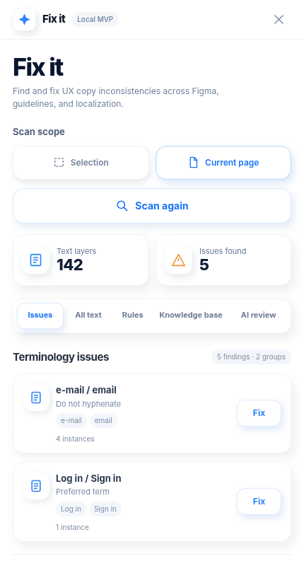

# Fix it

**AI-assisted UX content QA inside Figma.**  
A compact, read-only Figma plugin for finding terminology inconsistencies, inspecting text layers, and reviewing AI-generated suggestions against user-provided writing guidance.

> **Status:** working prototype (v0.7), not a production service. Figma and Claude Desktop must be configured separately. No Lokalise or code-repository synchronization has been implemented.



## The problem

UX copy is spread across design screens, localization resources, and writing guides. Comparing hundreds of UI strings manually is repetitive, and inconsistencies can survive into implementation.

**Fix it explores a lightweight content QA workflow:** scan → detect → inspect → propose → review. The plugin intentionally does **not** edit the design automatically.

## Available features

- Scan all text layers on the current Figma page, or only selected frames.
- Check custom avoid/prefer glossary rules and basic formatting.
- Group terminology findings, display source text, and select affected Figma layers with **Show**.
- Import your own CSV/JSON/TSV glossary, TXT/Markdown guide, or text-based PDF.
- Import a Confluence Cloud page through an **optional local bridge** using user-supplied credentials.
- Export a limited scan (up to 500 text layers) and user-supplied knowledge to a local Claude Desktop MCP companion.
- Review structured AI findings in the plugin after an agent submits them.
- 430 px-wide, white sidebar-style interface designed to keep the canvas visible.

## Not yet implemented

- Direct Lokalise integration or translation key matching.
- Git/codebase synchronization or automatic pull requests.
- Automatic invocation of Claude from the Scan button.
- Applying fixes to Figma layers automatically.
- OCR for scanned PDFs, automatic Confluence synchronization, or web-hosted accounts.

## Install in Figma

A Figma-issued **plugin ID** is needed for `figma.clientStorage`. The included `manifest.json` is a *template*; it deliberately does not contain a made-up ID.

1. In **Figma Desktop → Plugins → Development → New plugin**, create a Figma Design plugin with a custom UI.
2. Extract this repository and run `bash install-update.sh` (no Node.js needed for the plugin installer).
3. Select the registered plugin folder Figma just created. The installer copies the plugin files while preserving the Figma-issued ID.
4. Reopen the plugin from **Plugins → Development**.

Do not delete your registered folder before updating: its ID is used to access previously saved rules.

## Optional Claude Desktop MCP companion

Node.js is required only for the optional local services:

```bash
node setup-claude.mjs
```

This configures the local `fix-it` MCP server in Claude Desktop. Restart Claude Desktop, copy the connection code, and enter it in **AI review**.

**Flow:** scan in Figma → send scan to companion → ask Claude to review it using the Fix it MCP tools and your own guidelines → click **Refresh findings** in Fix it.

Claude is **not** automatically triggered from the Scan button, and a ChatGPT integration is **not** included in this version.

## Optional Confluence Cloud import

Run `node confluence-bridge.js` after supplying your own `ATLASSIAN_EMAIL` and `ATLASSIAN_API_TOKEN` environment variables. Copy the temporary connection code from Terminal into the plugin. Only pages that your account can access can be imported. This is a local prototype bridge, **not a deployable service**.

## Regression evals (local MVP)

The new **Evals** tab can run six synthetic UX writing regression cases or import your own private JSON suite. A connected local companion evaluates before/after copy using explicit deterministic checks and flags regressions. Results are stored in `~/.fix-it-local/evals/latest.json`.

This first version does **not** perform AI or blind grading. See [evals/README.md](evals/README.md) for supported assertions, case format and limitations.

## Tests

```bash
node test-manifest.cjs
node test-figma.cjs
node test-companion.cjs
node test-evals.cjs
node test-installer.cjs
```

The tests cover manifest structure, mocked Figma behavior, and the local scan-to-MCP-findings roundtrip. They are **not** a substitute for manual validation in Figma Desktop and Claude Desktop.

## Privacy and security

This repository contains **no employer-specific style guides, internal glossary files, exported production copy, Atlassian API tokens, or live scan data**. All demonstration material is synthetic.

User data is stored separately in Figma client storage and in a local companion directory (`~/.fix-it-local`); these are not part of the repository. The local services accept credentials supplied at runtime. **Do not commit** token files, user scans, exports, or company documents.

The Figma plugin performs deterministic scans locally. Opt-in Claude and Confluence workflows may transmit or process user-provided material under those vendors' terms. Verify your organization's policies before scanning confidential work.

## Why I built it

A prototype exploring how UX writing and content design can move beyond manual QA, combining deterministic terminology checks with explainable agent-assisted review and source-backed suggestions.

See [product decisions](docs/product-decisions.md) for the UX rationale and [architecture](docs/architecture.md) for the integration model.
